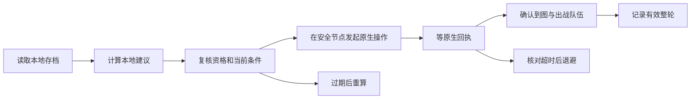

# 7.0.0 本地配队与选图验证

基线为工作区中的 6.3.14，脚本 SHA-256 为 `356e29684b9445bef096eefa23c94b958f72f3a097dfc67d3a52b8354ccfb925`。工作区 Git 的起点为 `1a369d0`，该仓库包含其他脚本；发布使用单独的 Catch 仓库。完整基准数据与复现方法见 [本地基准](./7.0.0-local-benchmark.md)。

## 调用链与失效

| 阶段 | 热点和复用方式 | 重算条件 |
| --- | --- | --- |
| A · 本地读取 | `Engine.read()` 复用原始字符串缓存。新的可解析存档生成一次 UID 索引；`partyMons()`、队伍指纹和界面查询复用后台索引。物种与位置在首次需要时构建。 | UID、形态、等级、地区、阶级、异色、永久数值修正、口味和禁用招式参与战力比较。金币、经验刻度和当前 HP 更新原始成员信息，治疗后模型继续复用相同战力档案。队伍、Buddy、地区侧、占用信息单独记录。 |
| B · 队伍搜索 | 复用原有短名单和战斗模型；完整合法候选进行多轮单成员替换复核，必要时比较顺序。 | 当前任务、敌人、天气、出战策略、固定成员和战力变化使相关计划重新计算。移除成员后的贡献是模型差值，不能换算为胜率。 |
| M · 地图 | 继续按解锁、地区、目标来源和窗口生成地图。净金币和指定学员有效经验保留各自的观测口径。 | 兼容历史依赖地图身份、出战队伍、速度、天气、增益与学员目标。刷钱和道具按任务本身的收益与资格选图。 |
| C · 执行 | 复用原有游戏循环和页面控制，共享配队、路线和预览的计算时间。 | 停止、手动操作、失去租约或来源变化取消待执行工作。点击发出后等当前游戏状态确认，超时后保持有界退避。 |



## 复现

```powershell
npm.cmd --prefix pokecatch-helper run build
npm.cmd --prefix pokecatch-helper run check
npm.cmd --prefix pokecatch-helper test
node --expose-gc pokecatch-helper/tools/benchmark-box.cjs
node pokecatch-helper/tools/benchmark-box-browser.cjs
```

完整 JSON 变化时仍需同步解析，分片计时不包含浏览器节流。离线浏览器使用合成存档与临时配置，验证助手计算路径，真实客户端自行发出的原生请求超出这些测量的范围。

发布构建 `abd6c5b730a6984541d9621e753b80273e608f602151ea16febe9130581ac5fd` 通过 1458 项离线用例，3 项跳过，临时 Chrome 的端到端夹具回归通过。

## 验收结果与使用边界

| 项目 | 本轮结果 |
| --- | --- |
| 纯分析出站 | Node API 桩与临时 Chrome 的拦截记录均为零。游戏同步入口和夹具操作计数均为零。正式浏览器、浏览器自己的进程级请求和原生游戏操作不在范围内。 |
| 本地开销 | 原文未变时解码/索引构建为零；仅金币、经验刻度或当前 HP 改变时，已缓存成员的战力档案重建为零。完整候选复核比旧版短名单更耗 CPU，1000 和 5000 只的严格压力样本超过预设验证完成耗时观察线。 |
| 配队正确性 | 合成反例覆盖短名单外的伤害倍率和抢先手、固定学员、相近候选、重复 UID、第二轮复核与双替换。地下小集合对照合法三人组穷举。复核证明仅绑定对应地图及已评分的有序阵容。设施自有队伍仍有专门的选择规则。 |
| 选图与观测 | 地图资格、跨钱包回执、同图重开、传说阶级和延迟落盘均有回归。刷钱针对重点地图配队比较，界面显示覆盖数量；指定练级按实际学员统计，未做全地图和全部储备阵容的联合枚举。普通路线和传说挑战具有明确进入回执；补练和天气等待期间挂机沿用各自的原生流程。 |
| 运行安全 | 不完整的严格配队结果仅供预览；存档失效、手动接管和过期动作可取消。可在助手中停止任务，或使用手动冒险配队；配置与游戏原存档兼容。 |
